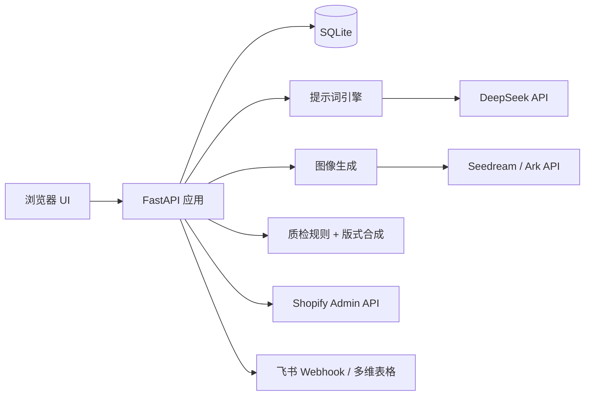

# NOVA · 电商视觉 AI 生产与质检中台

> 把电商详情页从外包 2–3 周压到 1–2 小时，且每张图可复核、可回滚。

一套跑在本机的电商视觉流水线：商品识别 → 提示词生成 → AI 生图 → 自动质检 → 商品草稿 → 一键上架，人只做终判。


## 目录

- [为什么做这个](#为什么做这个)
- [功能](#功能)
- [架构](#架构)
- [快速开始](#快速开始)
- [配置](#配置)
- [主要接口](#主要接口)
- [项目结构](#项目结构)
- [测试](#测试)
- [设计取舍](#设计取舍)
- [已知限制](#已知限制)
- [许可证](#许可证)

## 为什么做这个

一套电商详情页外包报价上千、周期 2–3 周；改一个字、改一次价还要整套重做。
目标是把「做图」拆成可复核、可复用的流水线：每一页都有输入、有产出、有验收标准，返工只重跑问题页。

## 功能

| 模块 | 说明 |
| --- | --- |
| 商品识别 | 输入商品信息或直接选类型，自动匹配该品类视觉方案 |
| 提示词体系 | DeepSeek 生成 9 层提示词，支持人工查看与编辑 |
| 套图生成 | 5 张主图（1:1）+ 7 张详情页（4:5）= 12 页/套，统一 2K |
| 自动质检 | 尺寸、比例、净空、错字、合规逐项校验，再人工终判 |
| 商品草稿 | 生成图一键转草稿，补 SKU、售价、库存、描述 |
| 上架 | Shopify 真实发布；淘宝/天猫走模拟发布；其余平台占位 |
| 改价风控 | 提交 → 审批 → 写回 → 回滚，价格历史与审批结果留档 |
| 任务中心 | 生图/发布任务排队、失败重试、状态与回滚 |
| 飞书协同 | 多维表格台账、审批流、群机器人推送进度 |

## 架构



## 快速开始

需要 Python 3.10+。

**Windows 一键**

```powershell
git clone https://github.com/Xxxnickname/nova-ecommerce-visual-studio.git
cd nova-ecommerce-visual-studio
.\scripts\setup.ps1      # 建 .venv 并装依赖
.\scripts\start.ps1      # 启动并打开浏览器（也可双击 scripts\start.vbs）
```

**任意平台**

```bash
python -m venv .venv
source .venv/bin/activate        # Windows: .venv\Scripts\activate
pip install -r requirements.txt
python app.py                    # 或：uvicorn app:app --port 8000
```

打开 http://127.0.0.1:8000 ，进入「设置」填写 Ark（Seedream）、DeepSeek、Shopify 与可选的飞书 Webhook。

> 密钥只保存在本机 `settings.json` 或环境变量，不写入代码，也不进入仓库。

首次启动会用 `products.json` 生成 12 个示例 SKU（配图为占位图 `samples/demo-product.png`），可以直接走完整流程；正式使用换成自己的商品与实拍图。

## 配置

页面「设置」可填写；服务器或 CI 建议用环境变量：

| 变量 | 说明 |
| --- | --- |
| `ARK_API_KEY` | 火山方舟 API Key（Seedream 生图） |
| `ARK_BASE_URL` | 默认 `https://ark.cn-beijing.volces.com/api/v3` |
| `ARK_MODEL_IMAGE` | 生图模型，默认 `doubao-seedream-5-0-flash-260915` |
| `DEEPSEEK_API_KEY` | DeepSeek Key（提示词规划） |
| `DEEPSEEK_MODEL` | 默认 `deepseek-flash` |
| `SHOPIFY_STORE` / `SHOPIFY_TOKEN` | Shopify 店铺域名与 Admin API Token |
| `FEISHU_WEBHOOK` | 飞书群机器人 Webhook（可选） |
| `ECOMMERCE_PORT` | 服务端口，默认 8000 |
| `ECOMMERCE_SETTINGS_PATH` | 配置文件路径，默认 `settings.json` |
| `ECOMMERCE_DB_PATH` | 数据库路径，默认 `data/data.db` |
| `ECOMMERCE_RUN_DIR` | 生成图与上传图目录，默认 `data/runs` |

也可复制 `.env.example` 为 `.env` 后填写。

## 主要接口

| 方法 | 路径 | 说明 |
| --- | --- | --- |
| POST | `/api/classify-product` | 商品类型识别 |
| POST | `/api/prompt-plan` | 生成整套提示词规划 |
| POST | `/api/generate` | 单图生成 |
| POST | `/api/generate-suite` | 12 张套图生成 |
| GET | `/api/jobs` | 任务列表 |
| POST | `/api/jobs/{id}/retry` | 失败重试 |
| POST | `/api/products/from-image` | 生成图转商品草稿 |
| POST | `/api/products/{sku}/publish` | 上架 |
| POST | `/api/approvals/{id}/approve` | 改价审批 |
| GET | `/api/health` | 健康检查 |

完整路由见 `app.py`。

## 项目结构

```text
.
├─ app.py                  FastAPI 入口与路由
├─ ecommerce/              业务模块：生图、提示词、质检、上架、飞书
├─ templates/              页面模板与品类/平台/模型配置
├─ static/                 前端静态资源
├─ prompt_packs/           12 页套图提示词包（运行时读取）
├─ samples/                示例占位图
├─ products.json           12 个示例 SKU（首次启动写入数据库）
├─ tests/                  pytest 用例
├─ docs/                   方案、部署与验收文档
├─ scripts/                setup / start / stop
├─ data/                   运行数据：数据库、生成图、日志（不入库）
├─ requirements.txt
└─ .env.example
```

## 测试

```bash
python -m pytest -q
```

当前 31 个用例，覆盖商品、任务、审批、任务中心与关键 API（Windows 11 / Python 3.10 实测全部通过）。

## 设计取舍

- **不自研模型**：用 Seedream 图生图 + 结构化提示词，把成本压在调用层。
- **不做每品类 LoRA**：一致性靠参考图、模板、风格锁与固定 seed，换品类只换模板。
- **文字不交给模型**：信息图先出无字背景，再由系统按安全边距排版，避免错字与越界。
- **人工终判**：机器只做可规则化的校验，审美与合规由人确认。

## 已知限制

- 中文文本仍可能出现错字，保留人工审阅与版式回退。
- 淘宝/天猫为模拟发布流程，未接入官方 API。
- 单机部署，未做多租户与权限体系。
- 需自备 Seedream / DeepSeek / Shopify 账号。

## 许可证

MIT License，见 [LICENSE](LICENSE)。© 2026 Xxxnickname

## 联系

- GitHub：[@Xxxnickname](https://github.com/Xxxnickname)